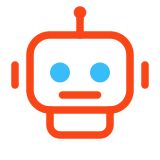

<div align="center">




<br/>


</div>

## About me

```python
class Ranuka:
    role     = "Associate Software Engineer"
    focus    = ["RPA", "Automation"]
    tools    = ["UiPath", "Python"]
    building = "bots that do the boring work"
    learning = ["AI + automation", "APIs"]
    open_to  = "community projects"

    def ask_me_about(self):
        return "Tech"
```

## How my bots work

`Trigger` → `Collect` → `Process` → `Act` → `Report`

Schedule or queue item starts the run, data is read from apps, files and APIs, Python cleans and validates it, the robot updates the target systems, and results and exceptions are logged.

## Tech stack

**Automation**&nbsp;&nbsp;


**Languages**&nbsp;&nbsp;


**Learning: DevOps ecosystem**&nbsp;&nbsp;


## Latest bot run

```log
[09:00:01] INFO  Robot started - process: daily_report
[09:00:04] INFO  Fetched 1,248 queue items
[09:03:42] INFO  Processed 1,248 / 1,248 items
[09:03:43] OK    0 exceptions - report sent
$ coffee --refill
```

## GitHub stats

<p align="center">
  
</p>

## Activity



## Let's connect

<a href="https://www.linkedin.com/in/ranukaharshana/"></a>

<div align="center">

<sub><i>"If you do it twice, automate it."</i></sub>


</div>
